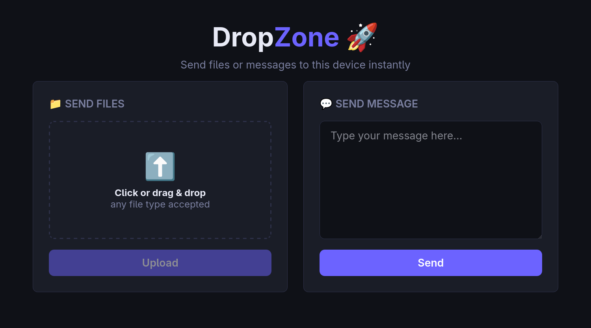

# DropZone 🚀

A minimal local-network file & message sharing CLI tool written in Rust.

<!-- 900x500 -->


### Features

- 📁 **File uploads** --- connected devices can drag and drop or select files
- 💬 **Text messages** --- typed messages are printed directly to your terminal
- 🌐 **Zero config** --- run `dropzone serve` and share the network URL or scan the QR code shown in the terminal
- 🎨 **Nice UI** --- dark-themed web page, works on mobile too

### Build & Run

```bash
# clone/copy the project, then:
cargo build --release

# run with HTTPS on the default port 8443
./target/release/dropzone serve

# or specify a custom port
./target/release/dropzone serve 5050
```

Open the network URL on another device on the same local network to send files or messages to the machine running DropZone. Files are saved on that machine; messages are printed to its terminal.

### Configuration

#### Uploads and request limits

Uploaded files are saved in `dropzone-uploads` relative to the working directory. Use `-o` or `--output` to choose another directory:

```bash
./target/release/dropzone serve --output ./received
```

There is no request-body size limit by default. Set `--max-body-size` or `DROPZONE_MAX_BODY_SIZE` to limit each request body in bytes:

```bash
./target/release/dropzone serve --max-body-size 104857600
# or:
DROPZONE_MAX_BODY_SIZE=104857600 ./target/release/dropzone serve
```

The limit applies to both file uploads and messages.

#### TLS

By default, DropZone runs with TLS (HTTPS mode). At each startup it generates a fresh self-signed ECDSA P-256 certificate and private key in memory.

> [!WARNING]
> Browsers will show a certificate warning. The generated certificate is not automatically trusted, and it changes every startup. Accepting the warning enables encrypted traffic but does not reliably verify the server's identity against an active attacker.

To use your own PEM certificate and private key instead, set both environment variables:

```bash
DROPZONE_CERT_PATH=/path/to/cert.pem DROPZONE_CERT_KEY_PATH=/path/to/key.pem ./target/release/dropzone serve
```

To run without TLS (unencrypted HTTP-only mode), use `dropzone serve --no-tls`. In this mode, certificate environment variables are ignored.

#### Network access

The server listens on all IPv4 interfaces (`0.0.0.0`), not just localhost. There is no authentication: anyone who can reach the port can upload files or send messages. Use it only on trusted networks and restrict access with your firewall as needed.

#### All available options

Use `dropzone serve --help` to show all server options.
